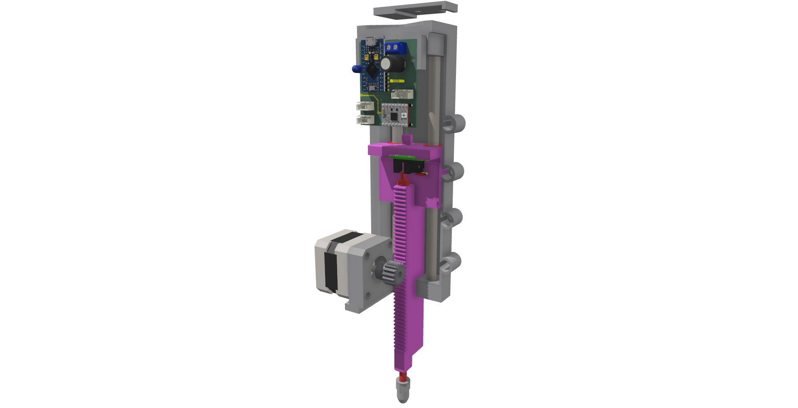
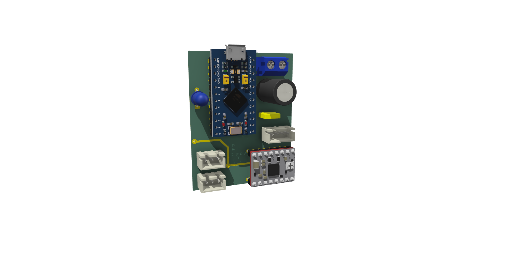
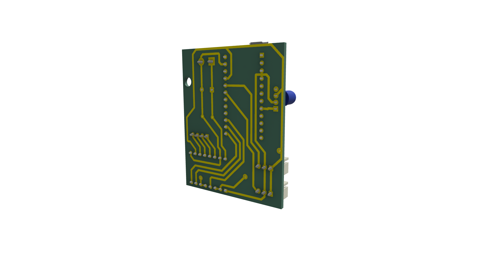
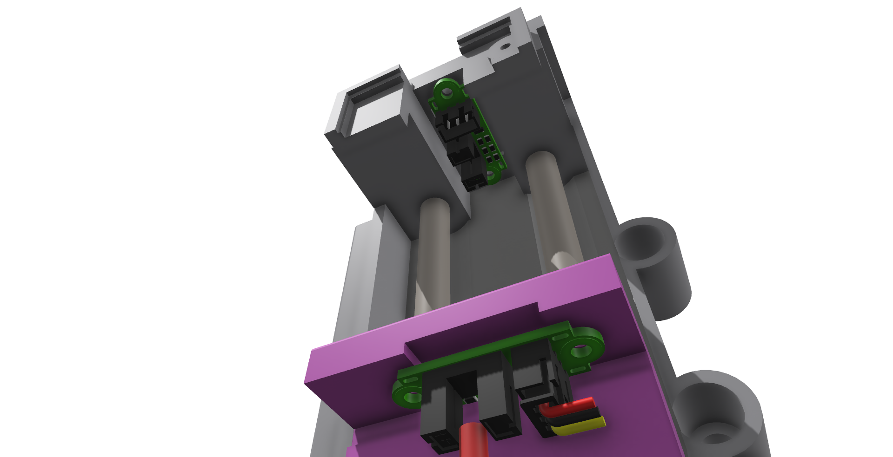
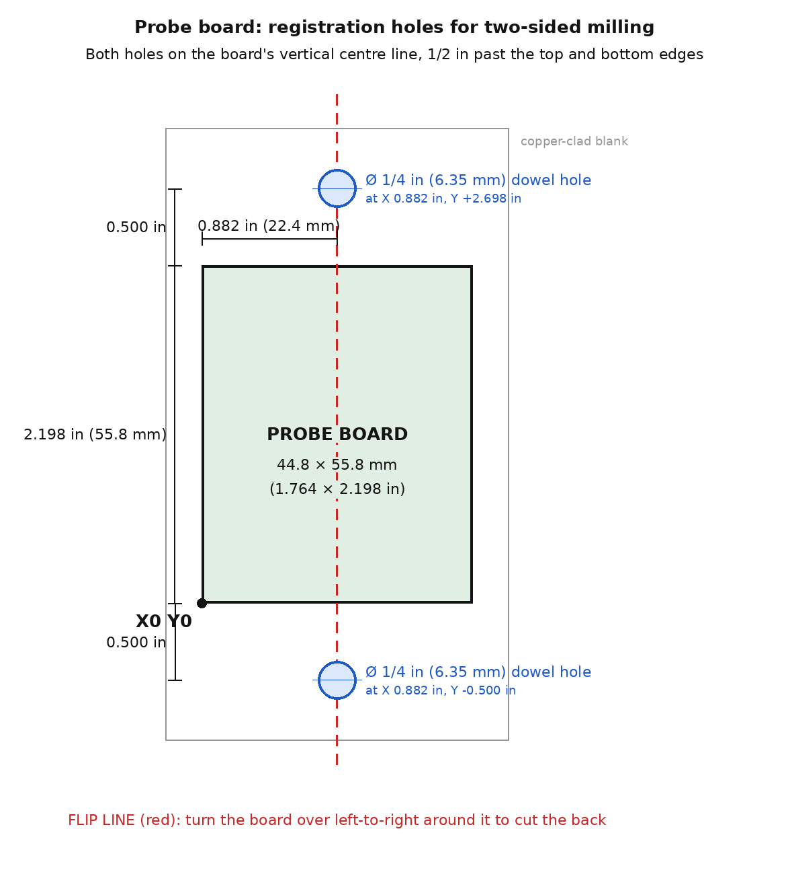

# Auto scanner device

A motor-driven surface probe that rides on the spindle of a PrintNC CNC router. A NEMA 17 drives a rack and
pinion that lowers a probe tip onto the work; an optical switch sees the touch, and a second one the end of
travel. An Arduino Pro Micro runs it through an A4988 driver and talks to the sender over USB, so the CNC can
scan the surface of the stock and level the G-code to it.

> **Made to work with [FluidNCSender](https://github.com/mikeoverbay/FluidNCSender)**, my G-code sender for FluidNC.
> Its Scan panel connects to the probe, moves the CNC over a grid of points, probes each one (allowing for the
> probe's offset from the spindle), and levels the G-code with the scan.
>
> Other senders can probably use it too, if they are changed to support it: the probe is a plain USB serial
> device with a few one-line commands (see [Serial commands](#serial-commands-one-per-line)).

## Pictures

| | |
|---|---|
|  |  |
| **Probe board, component side:** the Pro Micro, the A4988 driver, the RGB LED, the power terminal block, the capacitors, the 4-pin motor plug and the two 3-pin sensor plugs | **Probe board, trace side:** the copper traces |
|  |  |
| **The two optical switches:** the home (travel) switch on the frame at the top, and the touch switch riding on the slide | **The whole assembly** |

## 3D model

**[model/Auto Probe Addon.step](model/Auto%20Probe%20Addon.step)**: the whole design (Shapr3D, exported as STEP
AP242, millimetres), mounted on the PrintNC's Z axis and spindle. Each part's name in the model is followed by
the link it was bought from. It opens in Fusion 360, FreeCAD, Shapr3D, SolidWorks and most other CAD programs.

## Fits this spindle

The probe bolts straight onto the common **80 mm square, air-cooled spindle** with a side mounting plate:

- body 80 mm square, 166 mm long (272 mm overall with the nose and the fan cover);
- mounting plate 110 mm wide, with **4 holes on each side, 35 mm apart, the two rows 95 mm apart**;
- nose 62 mm across, collet nut 34 mm across.

## Parts list

See **[BOM.md](BOM.md)**: the bought parts with where they came from and how many, the parts to make, and how the
assembly goes together.

## Making the probe board

The board is milled on the CNC from a blank copper-clad board (the "prototype board" in the parts list) and cut on
both sides.

**Cutter.** The pads are about 1.5 to 1.7 mm across on a 2.54 mm (0.1 in) pitch, so only about 0.85 to 1.0 mm of
copper is left to cut between neighbouring pads, and less where a trace runs between them. The board here was cut
with a **1/32 in (0.79 mm)** end mill, which only just fits. A smaller one is better: **1/64 in (0.4 mm)**,
**0.5 mm**, or a fine-point V-bit.

**Level each side.** The copper is thin, so scan the blank with the probe and level the G-code before cutting
(FluidNCSender's Scan panel), once for each side.

**Two sides, with registration holes.** Two 1/4 in dowel holes on the board's vertical centre line, 1/2 in past
its top and bottom edges, put the board back in exactly the same place after it is turned over:

1. Fasten the blank to the spoilboard and set X0 Y0 at the board's lower-left corner.
2. Drill the two holes first, **through the blank and about 1/4 in into the spoilboard**, at X 0.882 in, Y −0.500 in
   and X 0.882 in, Y 2.698 in.
3. Cut the front: traces, then the component holes.
4. Unfasten the board, turn it over **left to right** (around the line through the two holes), and push 1/4 in dowel
   pins through the board into the spoilboard holes. Don't change X0 Y0.
5. Cut the back. Its G-code has to be **mirrored around the flip line** (X becomes 1.764 in − X); most PCB CAM
   programs do this when you pick the bottom side.
6. Cut the board's outline last, so it stays in the blank until the end.

1/4 in pins are stiff and easy to find. 1/8 in (3.175 mm) or 3 mm pins are also common for small boards, and the
shank of a drill bit of that size works as a pin.

## Code

The firmware is **[firmware/PROBE_OS/PROBE_OS.ino](firmware/PROBE_OS/PROBE_OS.ino)**, for the Arduino Pro Micro
(ATmega32U4: select *Arduino Leonardo* or a Pro Micro board in the Arduino IDE). It needs the **FastLED** library.
Over USB it shows up as "AutoProbe" by "Coffee CNC", a serial port at 115200 baud.

### Pins

| Pro Micro pin | Goes to |
|---|---|
| 5 | RGB LED (WS2811-type data line) |
| 21 (A3) | Home opto switch (`opto travel`) |
| 20 (A2) | Touch opto switch (`opto touch`) |
| 16 | A4988 STEP |
| 10 | A4988 DIR |
| 14 (A0) | A4988 MS3 |

### Serial commands (one per line)

| Command | Does | Answers |
|---|---|---|
| `H` | Home: retract fully. The next touch reads 0.0 | `homed` |
| `ZR:0.200` | How far to back off after a touch (inches) | `OK ZR=0.200` |
| `P` | Probe down to the surface | the height in inches, relative to the first touch after `H`; `ERROR` on a miss |
| `I` | Start probing (first touch) | |
| `X` | Go idle | |

Travel is 4.5 in. One step moves `0.03937 × 16 × π / 1600` in: the code takes the pinion's pitch circle as 16 mm
across and the motor as 1600 steps per turn.
